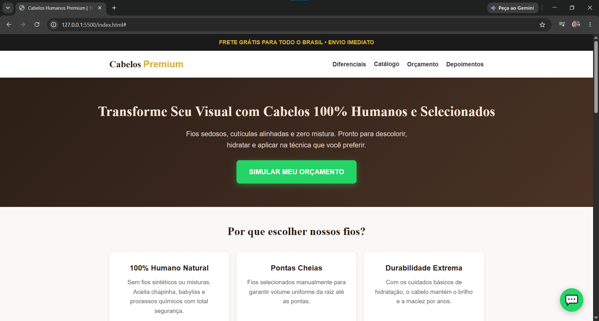

# 💇‍♀️ Cabelos Humanos Premium | Landing Page

Landing page interativa desenvolvida para apresentação e venda de cabelos 100% humanos e naturais, com foco em conversão, credibilidade visual e experiência do usuário (UX).

🔗 **Acesse o projeto no ar:** [Clique aqui para visualizar](https://ingrid1322.github.io/pagina-cabelos/)



---

## 🎯 Sobre o Projeto

Este projeto oferece uma vitrine digital completa e responsiva para o segmento de beleza e estética. Além de apresentar os diferenciais dos fios e um catálogo visual de texturas, a página conta com uma **calculadora de orçamento em tempo real** integrada diretamente ao **WhatsApp**, facilitando o fechamento de pedidos.

### ✨ Principais Funcionalidades
- **Navegação Fluida e Tipografia Sofisticada:** Barra de navegação fixa (`sticky`) com rolagem suave e combinação de fontes *Playfair Display* e *Poppins* via Google Fonts.
- **Catálogo Visual de Texturas:** Exibição padronizada dos fios (Liso Natural, Ondulado Leve e Cacheado Definido).
- **Calculadora Interativa de Orçamento:** Cálculo dinâmico e instantâneo do valor estimado conforme a textura, comprimento (cm) e quantidade/peso (g) escolhidos.
- **Pedido Inteligente via WhatsApp:** Geração automática de mensagem personalizada contendo o resumo exato da simulação feita pelo cliente, além de botão flutuante para atendimento rápido.
- **Prova Social e Confiança:** Seção de depoimentos de clientes e rodapé institucional com formas de pagamento e garantias.
- **Design Responsivo:** Layout adaptável para computadores, tablets e smartphones utilizando CSS Grid e Flexbox.

---

## 🛠️ Tecnologias Utilizadas

- **HTML5:** Estruturação semântica (`<nav>`, `<header>`, `<main>`, `<section>`, `<article>`, `<footer>`).
- **CSS3:** Estilização modular com variáveis globais (`:root`), CSS Grid, Flexbox, posicionamento `sticky` e transições suaves.
- **JavaScript (ES6+):** Manipulação do DOM, eventos dinâmicos, formatação de moeda (`toLocaleString`) e codificação de URL (`encodeURIComponent`) para integração com WhatsApp.
- **Google Fonts:** Tipografia personalizada para reforçar a identidade visual da marca.
- **Git & GitHub:** Versionamento de código seguindo boas práticas de commits semânticos e hospedagem via GitHub Pages.

---

## 📂 Estrutura de Pastas

```text
pagina-cabelos/
├── assets/
│   └── img/          # Imagens do catálogo e preview do README
├── css/
│   └── style.css     # Estilos globais, variáveis e layout responsivo
├── js/
│   └── script.js     # Lógica da calculadora e integração com WhatsApp
├── index.html        # Estrutura principal da página
├── LICENSE           # Licença do projeto
└── README.md         # Documentação do repositório
```

---

## 🚀 Como Executar o Projeto Localmente

1. **Clone este repositório:**
   ```bash
   git clone https://github.com
   ```

2. **Acesse a pasta do projeto:**
   ```bash
   cd pagina-cabelos
   ```

3. **Abra no navegador:**
   Abra o arquivo `index.html` diretamente no seu navegador ou utilize a extensão **Live Server** no VS Code.

---

## 📈 Evolução do Projeto (Concluídos)

- [x] Estruturação semântica e refatoração modular (HTML, CSS e JS separados).
- [x] Catálogo visual com fotos das texturas (Liso, Ondulado, Cacheado).
- [x] Calculadora interativa de orçamento por comprimento e peso em JavaScript.
- [x] Integração automática com WhatsApp e botão flutuante.
- [x] Seção de depoimentos e rodapé institucional.
- [x] Barra de navegação fixa (Navbar) e tipografia personalizada via Google Fonts.
- [x] Print da tela (screenshot) adicionado à documentação.

---

## 📸 Créditos
- Imagens ilustrativas retiradas do banco gratuito [Pexels](https://pexels.com).

---

## 👩‍💻 Autora

Desenvolvido por **Ingrid** — Desenvolvedora Front-end em constante evolução.